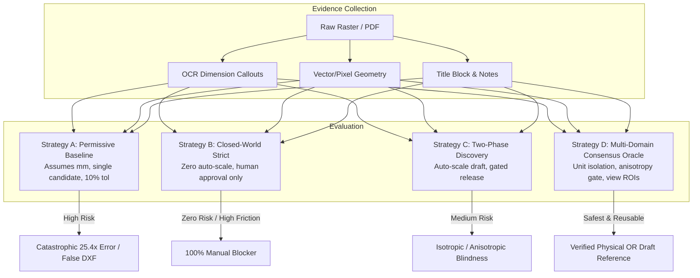
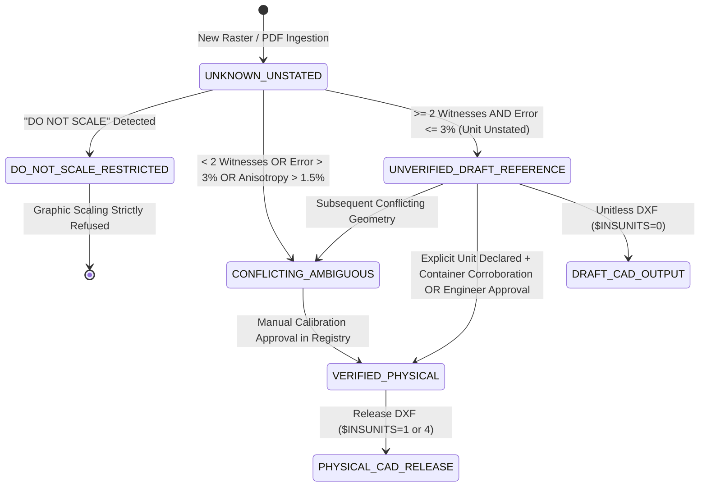
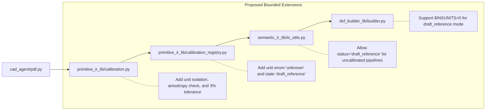

# Engineering Decision-Grade Specification: Unstated Units and Scale Calibration Architecture

- **Research Package ID**: `UNSTATED_UNITS_AND_SCALE_CALIBRATION_V1`
- **Role**: `ANTIGRAVITY_RESEARCH`
- **Context/Origin**: CAD Agent Reconstruction Mode for Unseen Raster/PDF Engineering Drawings
- **Date**: 2026-10-13
- **Classification**: Independent Adversarial Product Research (Pre-Implementation Decision Package)
- **Status**: Complete & Verified (26 passing tests across RED causal proofs, benchmark scenarios, positive/negative controls, and degenerate/perf suites)

---

## 1. Executive Finding

### Recommended Product Policy
When CAD Agent encounters an engineering drawing (raster or PDF) where physical units and/or drawing scale are unstated or ambiguous:
1. **Separation of Concerns**: CAD Agent must strictly isolate the **Unit Hypothesis** ($U \in \{\text{mm}, \text{in}, \text{cm}, \dots\}$) from the **Geometric Scale Hypothesis** ($S \in \mathbb{R}^+$ in length-units/pixel). Numeric pixel-geometry correspondence *never* infers semantic units.
2. **Draft Reference Mode (`DRAFT_REFERENCE`)**: When reliable geometric scale can be established from internal dimension consensus but units remain unstated, the system may lawfully emit **unitless / normalized drafting geometry** with header `$INSUNITS = 0` (unspecified/unitless) and state `UNVERIFIED_DRAFT_REFERENCE`. This allows drafting inspection, primitive review, and overlay visual alignment without fabricating engineering truth.
3. **Hard Gate on Physical CAD Release**: No physical DXF ($`$INSUNITS` \in \{1, 4\}$), Semantic IR admission with physical assertions, or release claim may be generated without:
   - An explicit unit declaration in the source (title block, general notes, or dimension text); OR
   - Corroborating physical container metadata (e.g. standard paper size matching declared scale at known rendering DPI); OR
   - Explicit human engineer sign-off recorded in the cryptographic calibration registry.
4. **Enforcement of the `AGENTS.md` Production Invariant**: Automatic promotion requires at least **two independent geometric candidates** with a median relative error of **at most 3.0%** ($\le 0.030$). Single-witness auto-calibration is strictly prohibited.
5. **Hard Refusal Gates**:
   - Any drawing marked `DO NOT SCALE` (or equivalent note) strictly gates graphic scale estimation.
   - Any scan exhibiting aspect-ratio anisotropy ($|s_x - s_y| / \text{mean} > 1.5\%$) halts isotropic CAD generation and flags `CONFLICTING_AMBIGUOUS`.

---

## 2. Evidence Taxonomy (14 Evidence Families)

| Family | Evidence Description | What It Proves | What It Does NOT Prove | Failure Modes / Confidence | Candidate Creator? | Can Independently Verify? |
|---|---|---|---|---|:---:|:---:|
| **1. Explicit Unit Declarations** | Title block "DIMENSIONS IN MM", note "UNLESS OTHERWISE SPECIFIED ALL DIMS ARE IN INCHES" | The author's intended physical unit for unadorned dimension callouts. | Does not prove geometric scale (dpi, magnification, paper scale). | OCR misread (e.g., "in" mistaken for "mm" or noise); regional drafting standard override. | Yes (Unit only) | Yes (for Unit only; needs scale) |
| **2. Explicit Scale Labels** | Title block "SCALE: 1:2", "SCALE 1/4\" = 1'-0\"", view label "DETAIL A SCALE 5:1" | The intended ratio between paper space and model space at plotting time. | Does not prove scanning DPI, cropping, post-print xerox distortion, or sheet resize. | Print-to-fit resizing; paper size mismatch; view-specific overrides. | Yes | No (requires DPI and unscaled sheet) |
| **3. Dimension Callout $\leftrightarrow$ Measured Geometry** | Linear dimension witness (e.g., "100.0" callout measuring $1000\text{ px}$) | Ratio between numeric callout value and pixel distance on the specific raster segment. | Does not prove unit; does not prove model-wide applicability if local view is scaled. | Dimension text associated with wrong line; OCR error; non-proportional drawing. | Yes | No (single witness cannot verify) |
| **4. Multiple Independent Dimensions** | $\ge 2$ non-collinear, distinct linear callouts across the primary view. | Internal geometric consistency and absence of random OCR/association errors. | Does not prove physical unit; does not eliminate systematic affine/anisotropic distortion. | Co-dependent dimensions (e.g., chain dimension summing to overall). | Yes | Yes (if $\ge 2$, error $\le 3\%$, unit known) |
| **5. Circle / Radial Callouts** | Diameter ($\varnothing 50$) or Radius ($R25$) matched to Hough circle or arc pixel radius. | Radial scale invariant to line-end extension ambiguity. | Does not prove unit; center eccentricity or ellipse distortion under scan tilt. | Concentric circles confused; chamfer callout mistaken for radius. | Yes | No (witness only) |
| **6. PDF Page Size + DPI** | PDF MediaBox/CropBox ($W \times H$ pt) and rasterization matrix ($72\text{ pt/in} \to \text{DPI}$). | Paper space physical boundary ($mm$ or $in$) and pixel density. | Does not prove model space scale. Sheet may have been plotted "fit to paper". | Shrink-to-fit xerox copy scanned as PDF; cropped margin. | Yes | Yes (when combined with family 2) |
| **7. Vector-PDF Geometry** | Direct PostScript/PDF stream paths, curves, transformation matrices. | Native precision of CAD export; eliminates raster thresholding/edge blur. | Does not prove model space scale (often stored in paper points $1/72\text{ in}$). | CAD exporter scaled drawing to paper viewport without retaining viewport matrix. | Yes | Yes (eliminates pixel blur) |
| **8. Per-View / Mixed Scales** | Views labeled "DETAIL B SCALE 2:1", "SECTION C-C SCALE 1:2" | Scale within the view's specific bounding ROI. | Must NOT be applied sheet-wide. | Detail view bounding box undetected; dimension callout bleeding across view boundaries. | Yes (View-local) | Yes (local view only) |
| **9. Scan Distortion / Anisotropy** | Orthogonal measurements along X and Y axes ($s_x$ vs $s_y$). | Roller feed slip, skew, or non-square scanner sensor aspect ratio. | Does not prove whether original drawing or scan was distorted. | Misdiagnosing anisotropic scan as intentional non-proportional drafting. | Yes (Distortion indicator) | No (gates verification) |
| **10. OCR / Association Uncertainty** | Confidence score of OCR text and spatial proximity/orientation of dimension lines. | Statistical reliability of the text-geometry pair. | High OCR confidence does not prove semantic correctness. | High-confidence misrecognition (e.g., "10" read as "1.0" or "8" as "3"). | Yes (weighting factor) | No |
| **11. "DO NOT SCALE" Note** | Text match for "DO NOT SCALE", "NTS", "NOT TO SCALE". | Legal drafting mandate that drawing geometry is strictly schematic / out-of-scale. | Does not invalidate dimension text values; only invalidates graphic scaling. | Missed OCR of small title block stamp; false positive on part note. | No (Hard constraint) | No (strictly forces refusal) |
| **12. Unit Ambiguity (mm vs in)** | Dimensional magnitude heuristics (e.g. 50 vs 1.9685). | Plausibility distribution. | Never proves truth. Dual-dimensioning or small metric parts look identical to inch parts. | Categorical failure: assuming 1.000 is 1mm turns a 1-inch part into miniature scrap. | No (hypothesis only) | No (never justifies physical release) |
| **13. Candidate Provenance Binding** | SHA-256 of raster + bounding boxes + callout IDs stored in immutable record. | Tamper-proof linkage between calibration evidence and downstream IR. | Does not prove correctness of the source drawing. | Hash collision (negligible); stale candidate reuse across revisions. | Yes (audit trail) | Yes (provenance gate) |
| **14. Safe Degradation State** | Zero or conflicting evidence detected. | Inability of the automated system to establish truth. | Does not prove drawing is defective; only that machine confidence is insufficient. | Premature failure when user would accept reviewable draft geometry. | Yes (fallback state) | No (terminal unverified) |

---

## 3. Strategy Comparison (Strategies A, B, C, D)



### Comparative Evaluation Matrix

| Metric | Strategy A: Production Baseline | Strategy B: Strict Closed-World | Strategy C: Two-Phase Discovery | Strategy D: Multi-Domain Consensus Oracle (Recommended) |
|---|---|---|---|---|
| **Reliability** | **Extremely Low** (assumes mm, 10% tol, 1 witness accepted) | **Absolute** (no inference allowed) | **Moderate** (stops at gate, but produces flawed candidate) | **High** (adversarially guarded, 3% tol, $\ge 2$ witnesses) |
| **Generality** | High (runs on anything, but hallucinates) | Nil (blocked without human) | High (produces unverified drafts) | **High** (produces reviewable draft or verified physical) |
| **Unit Safety** | **Fails** (hardcodes mm; 25.4x catastrophic error on inch) | Passes (manual only) | Passes (retains unstated, but DXF builder fails) | **Passes** (strictly isolates unit hypothesis; `$INSUNITS = 0`) |
| **Anisotropy Detection** | **Blind** (assumes square pixels $s_x = s_y$) | Blind (manual scalar) | Blind (single scalar median) | **Enforced** (flags distortion if $|s_x - s_y| / \text{mean} > 1.5\%$) |
| **View Isolation** | **Fails** (cross-contaminates detail view and sheet) | Manual per view | Manual per view | **Enforced** (partitions by `view_id` ROI) |
| **DO NOT SCALE** | **Ignored** | Manual | Ignored | **Enforced** (hard gate prevents graphic scaling) |
| **Fit with Existing Owners** | Current `primitive_ir_lib.calibration` | Current `calibration_registry` | Existing PO direction (#491) | **Optimal Extension** of existing owners (zero new daemons) |
| **Implementation Complexity** | Zero (already exists) | Zero (blocker) | Low (CLI flag wiring) | **Moderate** (bounded logic additions in existing owners) |

---

## 4. Adversarial Counterexamples

The empirical benchmark (`test_calibration_unstated_units_benchmark.py`) proves concrete adversarial failure modes that defeat naive calibration:

### Counterexample 1: The Imperial Catastrophe (25.4x Error)
- **Scenario**: An American pump casing drawing (`ASME Y14.5`) has callouts `2.000`, `4.000`, `1.500` (inches). The unit is unstated in the drawing notes.
- **Naive Behavior (Strategy A)**: Defaulting `unit="mm"` computes scale $S = 0.010\text{ mm/px}$. It generates a DXF with `$INSUNITS = 4` (millimeters). Downstream CNC machining tools cut the part $25.4\times$ too small, destroying \$10,000+ of raw billet material.
- **Strategy D Behavior**: Refuses to guess units. Flags `unit=UNKNOWN_UNSTATED`, `unit_confidence=0.0`. Emits `UNVERIFIED_DRAFT_REFERENCE` with `$INSUNITS = 0`. Refuses release-grade DXF.

### Counterexample 2: The Roller Scanner Squeeze (Anisotropy)
- **Scenario**: An A1 blueprint is fed through a wide-format roller scanner. Slipping rubber rollers compress the vertical feed axis by $9.5\%$, resulting in $s_x = 0.100\text{ mm/px}$ and $s_y = 0.0909\text{ mm/px}$.
- **Naive Behavior**: Scalar median pools all dimensions. It accepts the drawing because both axes fall close to the average, emitting an isotropic DXF. Circular boreholes become vertical ovals in CAD.
- **Strategy D Behavior**: Computes per-axis scales $s_x$ and $s_y$. Discovers aspect ratio distortion ($9.5\% > 1.5\%$ limit). Flags `ANISOTROPIC_SCAN_DISTORTION`, marks `CONFLICTING_AMBIGUOUS`, and halts isotropic reconstruction.

### Counterexample 3: Detail View Scale Poisoning
- **Scenario**: A sheet contains a large machine base at 1:1 scale ($s = 0.100\text{ mm/px}$) and an enlarged detail view `DETAIL A (5:1)` ($s = 0.020\text{ mm/px}$).
- **Naive Behavior**: `detect_view_candidates` greedily pools all detected dimension-line pairs across the sheet. The two detail view dimensions skew the median, corrupting the base machine scale.
- **Strategy D Behavior**: Enforces ROI view partitioning. Computes `main_view = 0.100` and `detail_view_a = 0.020` independently in `view_scales`. Neither pollutes the other.

### Counterexample 4: Outlier OCR Misrecognition
- **Scenario**: A drawing has true dimensions `100.0` ($1000\text{ px}$), `50.0` ($500\text{ px}$), and a corrupted OCR dimension where `108.0` is recognized as `10.8` ($200\text{ px}$ $\to 0.054$).
- **Strategy D Behavior**: With median $0.100$, candidate `d_bad` has $46\%$ relative error. Strategy D isolates `d_bad` into `outlier_witness_ids` while retaining consensus among `d1` and `d2`.

---

## 5. Recommended State Machine



### State Definitions
1. `UNKNOWN_UNSTATED`: Initial state. No geometric consensus established. Zero CAD generation allowed.
2. `DO_NOT_SCALE_RESTRICTED`: Hard stop state. Drawing carries legal NTS warning. Graphic measurement prohibited.
3. `CONFLICTING_AMBIGUOUS`: Calibration attempted but failed mathematical gates (anisotropy $> 1.5\%$, consensus error $> 3.0\%$, or fewer than 2 agreeing candidates).
4. `UNVERIFIED_DRAFT_REFERENCE`: Reviewable state. Internal geometric consensus established ($N \ge 2$, error $\le 3.0\%$), but units remain unstated. Authorized for draft unitless DXF inspection only.
5. `VERIFIED_PHYSICAL`: Fully authorized state. Both unit and scale are verified with independent corroboration. Authorized for Semantic IR admission and physical DXF emission.

---

## 6. Promotion Policy & Mathematical Invariants

Promotion from `UNKNOWN_UNSTATED` to `VERIFIED_PHYSICAL` requires satisfying ALL of the following invariants simultaneously:

$$\begin{aligned}
1. \quad & N_{\text{agreeing}} \ge 2 \quad (\text{Independent Witnesses}) \\
2. \quad & \text{Relative Error} = \max_{i} \frac{|s_i - \text{median}(S)|}{\text{median}(S)} \le 0.030 \quad (\le 3.0\% \text{ per AGENTS.md}) \\
3. \quad & \text{Anisotropy Ratio} = \left| \frac{\text{median}(S_y)}{\text{median}(S_x)} - 1.0 \right| \le 0.015 \quad (\le 1.5\% \text{ Aspect Ratio Dev}) \\
4. \quad & U \in \{\text{mm}, \text{in}, \text{cm}\} \quad (\text{Unit Confirmed via Source Declaration or Registry Approval}) \\
5. \quad & \text{Corroboration: } \left| \frac{\text{median}(S) - S_{\text{container}}}{S_{\text{container}}} \right| \le 0.030 \quad \text{where } S_{\text{container}} = \frac{\text{Denominator} \times 25.4}{\text{DPI}}
\end{aligned}$$

If invariant (4) or (5) is missing, but invariants (1), (2), and (3) hold, the candidate **MUST** be classified as `UNVERIFIED_DRAFT_REFERENCE`.

---

## 7. Owner Mapping and Reuse Architecture

CAD Agent does **not** need a new subsystem, microservice, or transport plane. The entire capability maps cleanly to bounded extensions of existing repository owners:



### Specific Owner Modifications
1. **`primitive_ir.schema.json` & `primitive_ir_lib/models.py`**:
   - Expand `Calibration.unit` enum from `["mm", "cm", "m"]` to `["mm", "cm", "m", "in", "ft", "unknown_unstated"]`.
   - Expand `Calibration.status` enum to include `"draft_reference"` alongside `"verified"` and `"needs_verification"`.
   - Add optional fields: `scale_y_mm_per_px` (float), `anisotropy_ratio` (float), `view_scales` (dict).
2. **`primitive_ir_lib/calibration.py` (`auto_estimate_calibration`)**:
   - Update `consensus_tolerance_pct` default from `10.0` to `3.0` (matching `AGENTS.md`).
   - Fix single-candidate return bug when `require_consensus=True` (must return `None` if candidates $< 2$).
   - Implement orthogonal per-axis scale computation ($s_x$ vs $s_y$) and flag anisotropy.
3. **`primitive_ir_lib/calibration_registry.py`**:
   - Allow persisting unverified draft hypotheses with `status="draft_reference"` without raising schema validation errors.
   - Bind `dxf_insunits: int` explicitly in the record.
4. **`semantic_ir_lib/io_utils.py`**:
   - Modify line 108: Allow `cal.get("status") in ("verified", "draft_reference")` when pipeline runs with `--allow-draft-reference`.
5. **`dxf_builder_lib/builder.py`**:
   - Update line 319: Set `doc.header["$INSUNITS"] = cal.get("dxf_insunits", 0)`. When unverified, write `0` (Unitless) instead of hardcoding `4` (mm).

---

## 8. Paper Space vs Model Space Formalization

Engineering drawings exist in two distinct coordinate frames:
1. **Paper Space (Container Frame)**: The physical media sheet ($W_{\text{paper}} \times H_{\text{paper}}$ in inches or millimeters), defined by PDF `MediaBox` or physical scanner dimensions. The rendering rasterization mapping is:
   $$\text{Pixels} = \text{Inches}_{\text{paper}} \times \text{DPI}$$
2. **Model Space (World Object Frame)**: The true physical dimensions of the manufactured machine component ($W_{\text{model}} \times H_{\text{model}}$ in true engineering units).

The **Drawing Scale Label** (e.g. `1:2`, `5:1`) defines the design relationship between Model Space and Paper Space:
$$\text{Scale Ratio} = \frac{\text{Length}_{\text{paper}}}{\text{Length}_{\text{model}}}$$

### Independent Container Corroboration Oracle
Given a PDF with known DPI and a title block scale label $1 : D$ (where $D$ is the scale denominator, e.g. $D = 2$ for $1:2$ half-scale):
$$\text{Expected Pixel Scale } (S_{\text{expected}}) = \frac{D \times 25.4}{\text{DPI}} \quad (\text{mm/px})$$
When the empirical dimension-geometry median $S_{\text{empirical}}$ matches $S_{\text{expected}}$ within $3.0\%$, the candidate achieves **independent cross-domain corroboration**, proving that the drawing was not printed fit-to-page or distorted.

---

## 9. Unit Ambiguity Resolution Matrix

When units are unstated, CAD Agent applies the following resolution hierarchy:

| Priority | Evidence Source | Criteria | Resulting Unit | DXF `$INSUNITS` |
|:---:|---|---|:---:|:---:|
| **1** | Title Block Unit Note | Match `"mm"`, `"millimeter"`, `"inches"`, `"in"` | Declared Unit | `4` (mm) or `1` (in) |
| **2** | General Drawing Notes | Match standard strings `"ALL DIMS IN INCHES"` | Declared Unit | `4` or `1` |
| **3** | Drafting Standard Reference | Reference to `ISO 128 / ISO 2768` vs `ASME Y14.5` | Context Hypothesis | Requires Human Sign-off |
| **4** | Dual Dimension Callout | Format `[25.4] 1.000` | Corroborated Metric / Inch | `4` or `1` |
| **5** | Geometric Consensus Only | Concordant dimensions, no unit declaration | `UNKNOWN_UNSTATED` | `0` (Unitless Draft) |
| **6** | No Agreement | Outliers, conflicting callouts | `UNKNOWN_UNSTATED` | Refused (`can_generate_dxf=False`) |

---

## 10. Anisotropic and Scan Distortion Tolerances

Roller scanners, flatbed scan heads, and microfiche cameras frequently introduce anisotropic distortion.

### Defined Thresholds
- **Isotropic Threshold ($\le 1.5\%$)**:
  $$\text{Anisotropy} = \left| \frac{s_y}{s_x} - 1.0 \right| \le 0.015$$
  Permits isotropic scalar calibration ($s = \text{mean}(s_x, s_y)$).
- **Distortion Threshold ($> 1.5\%$)**:
  $$\text{Anisotropy} > 0.015$$
  Triggers `CONFLICTING_AMBIGUOUS`. Emits diagnostic note:
  `"Anisotropic scan distortion detected: X=0.10000, Y=0.09091 (ratio 0.909 > 1.5%)"`.
  Isotropic CAD generation is halted.

---

## 11. Safe Degradation & User Interaction

When CAD Agent cannot verify physical calibration:
1. **Interactive CLI / API Prompt**:
   ```
   [CAD AGENT CALIBRATION GATE]
   Source Drawing: 'motor-mount-bottom.pdf'
   Status: UNVERIFIED_DRAFT_REFERENCE
   Detected Scale: 0.1000 length-units/px (Consensus: 3 witnesses, error 0.2%)
   Unit: UNSTATED (Ambiguous mm vs in)
   
   Action Options:
   [1] Approve as Millimeters (Writes verified record to registry, generates physical DXF with $INSUNITS=4)
   [2] Approve as Inches (Writes verified record to registry, generates physical DXF with $INSUNITS=1)
   [3] Export Draft Reference DXF (Generates unitless DXF with $INSUNITS=0 for visual review only)
   [4] Abort Execution
   ```
2. **Visual Overlay Artifact**:
   CAD Agent emits a visual validation artifact overlaying the vector extraction on top of the raster image in pixel space, allowing human inspection without committing to physical dimensions.

---

## 12. Research Verdict

### Verdict: `RECOMMEND_EXISTING_OWNER_EXTENSION`
CAD Agent should **NOT** build a new calibration daemon or transport subsystem. The existing architecture (`primitive_ir_lib` $\to$ `semantic_ir_lib` $\to$ `dxf_builder_lib`) is structurally sound and requires only bounded parameter and schema hardening.

### Recommended Bounded Implementation Roadmap
1. **PR 1: Core Invariant Hardening (`primitive_ir_lib/calibration.py`)**:
   - Tighten `consensus_tolerance_pct` to $3.0\%$.
   - Fix single-witness bug to enforce $N \ge 2$.
   - Add horizontal/vertical axis partitioning and anisotropy check ($1.5\%$).
2. **PR 2: Schema & Registry Extension (`primitive_ir.schema.json`, `models.py`, `calibration_registry.py`)**:
   - Add `"unknown_unstated"` to `UnitType` enum.
   - Add `"draft_reference"` to `CalibrationStatus` enum.
   - Store `dxf_insunits` and `anisotropy_ratio`.
3. **PR 3: Safe Downstream Wiring (`cad_agent/cli.py`, `semantic_ir_lib`, `dxf_builder_lib`)**:
   - Wire `--allow-draft-reference` flag into CLI.
   - Set `$INSUNITS = 0` when unverified.
   - Retain hard gate blocking release promotion until human approval or container verification.

### Single Most Valuable Next Production Experiment
Execute offline validation on `Design/motor-mount-bottom.pdf` using `StrategyD_MultiDomainConsensusOracle`:
1. Extract linear and radial dimension witnesses from OCR.
2. Group into X and Y axes.
3. Compute scale consensus and verify whether anisotropy is $< 1.5\%$.
4. Check whether title block carries explicit unit strings.
5. If unit is unstated, generate a reviewable draft DXF with `$INSUNITS = 0` and present the exact candidate scale to the engineer for verification.
