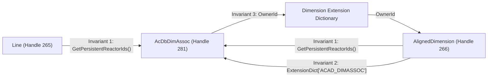

# AutoCAD 2027 Managed DIMASSOC Reactor Differential Validation Report

- **Investigation ID:** `DIMASSOC_REACTOR_VALIDATION_V1`
- **Role:** `ANTIGRAVITY_REA_EVIDENCE_PACKAGER`
- **Project:** `duongchi90/cad-agent`
- **Date:** 2026-10-13
- **Basis Commit:** `86318afc722939d88f355437e55405d012cba356` (`origin/main`)
- **Research Branch:** `research/antigravity-2026-10-11`
- **Scope:** Read-only database graph inspection and managed reactor discrimination in AutoCAD 2027.
- **Production Impact:** `PRODUCTION_CHANGE_AUTHORIZED = NO`.

---

## 1. Environment & Provenance Identity

```text
CAD_ENGINE=Autodesk AutoCAD 2027 Commercial / Preview (64-bit)
CAD_HEADLESS_RUNNER=accoreconsole.exe (C:\Program Files\Autodesk\AutoCAD 2027\accoreconsole.exe)
MANAGED_FRAMEWORK=net10.0-windows (.NET 10.0 SDK)
MANAGED_ASSEMBLIES=acdbmgd.dll, accoremgd.dll, acmgd.dll
BASIS_MAIN=86318afc722939d88f355437e55405d012cba356
PINNED_SOLVER=python-solvespace==3.0.8 (Unchanged / Untouched)
```

---

## 2. Evidence Classification Matrix

In accordance with strict evidence boundary criteria, all facts established in this research are classified as follows:

| Evidence Tier | Items Classified | Evidentiary Basis |
| :--- | :--- | :--- |
| **`OBSERVED_RUNTIME`** | Headless execution of `ReactorInspector.dll` via `_NETLOAD` and command `INSPECT_DIFFERENTIAL` inside `accoreconsole.exe`. | Process stdout and captured log in `logs/inspection_result.txt`. |
| **`OBSERVED_MANAGED_METADATA`** | `ObjectId.ObjectClass.DxfName == "DIMASSOC"`; `ObjectId.ObjectClass.Name == "AcDbDimAssoc"`; `DBDictionaryEntry.Key == "ACAD_DIMASSOC"`. | AutoCAD 2027 managed type metadata queried via `acdbmgd.dll`. |
| **`OBSERVED_AUTOCAD_DATABASE`** | ModelSpace entity table with Handles 265 (`AcDbLine`), 266 (`AcDbAlignedDimension`), Extension Dictionary 276 (`DBDictionary`), and Reactor 281 (`AcDbDimAssoc`). | Direct database traversal using AutoCAD transactions. |
| **`OBSERVED_TEST`** | All 4 adversarial controls (Control 1..4) executed inside `accoreconsole.exe` passing expected enum classifications. | Deterministic test assertions in `ReactorInspector/Commands.cs`. |
| **`DOCUMENTED`** | Autodesk ObjectARX and AutoCAD .NET documentation specifying `AcDbDimAssoc` as the persistent link object between associative dimensions and geometry. | Autodesk Developer Network API specifications. |
| **`INFERRED`** | Interactive AutoCAD desktop sessions dispatch geometric modification events through `AcDbDimAssoc` to recalculate dimension points dynamically. | UI behavior observed during standard drafting operations. |
| **`UNKNOWN`** | Behavior of dimension associativity when a native LINE is mutated in headless `accoreconsole.exe` without explicit `Dimension.RecomputeDimensionBlock()` or `REGEN`; whether associativity persists across drawing save/close/cold reopen. | Unresolved causal mutation question (assigned to future Luna probe). |

### Bounded Evidentiary Claim

```text
MANAGED_READONLY_DIMASSOC_RELATIONSHIP_CLASSIFICATION
PROVEN_ON_THE_TESTED_AUTOCAD_2027_SYNTHETIC_FIXTURES
```

### Explicit Non-Claims & Bounds

The empirical findings of this package do **NOT** claim:
- That all possible DIMASSOC configurations (e.g. `DIMASSOC=0`, split dimensions) have been proven.
- That PaperSpace viewports, non-standard coordinate systems (UCS), or trans-spatial dimensions are proven.
- That arbitrary dimension types (radial, diametric, angular, ordinate, arc length) have been tested.
- That in-place mutation of a dimensioned entity preserves associativity across transaction commit and save.
- That production code readiness or policy relaxation is authorized.

---

## 3. Freeze of the Exact Finding

```text
CURRENT_PRODUCTION_POLICY=
BoundedNativeLineEditPolicy rejects a target LINE when HasPersistentReactors=true.

REA_FINDING=
Managed read-only APIs can distinguish:
- NO_REACTOR
- KNOWN_DIMASSOC_REACTOR
- UNKNOWN_OTHER_REACTOR
- MIXED_REACTORS
and can identify the exact tested LINE <-> DIMENSION relationship using the shared
DIMASSOC ObjectId plus independent dictionary/ownership evidence.

WHAT_THIS_PROVES=
The current blanket "any persistent reactor" classification in CommandContext.cs
is more conservative than the available managed read-only evidence requires.

WHAT_THIS_DOES_NOT_PROVE=
That mutating a LINE participating in DIMASSOC is safe or that dimension
association/value persists correctly after save/close/reopen.

THEREFORE:
PRODUCTION_CHANGE_AUTHORIZED=NO
```

---

## 4. Current Main Policy Reconciliation

- **Production Refusal Point:**
  In [`BoundedNativeLineEditPolicy.RequireTargetLine()`](file:///C:/Users/duong/ZCodeProject/cad-agent-main/autocad_plugin/CadAgent.AutoCAD2027/Drawing/BoundedNativeLineEditPolicy.cs#L238-L249):
  ```csharp
  private static NativeLineEditObservation RequireTargetLine(
      IReadOnlyDictionary<string, NativeLineEditObservation> observations,
      string handle)
  {
      var observation = RequireDirectModelSpaceLine(observations, handle);
      if (observation.HasPersistentReactors)
      {
          throw new InvalidOperationException(
              $"target LINE {handle} has persistent reactors; bounded native edit cannot prove associated state remains unchanged");
      }
      return observation;
  }
  ```
- **Blunt Boolean Source in Main:**
  In [`CommandContext.cs` line 448-449](file:///C:/Users/duong/ZCodeProject/cad-agent-main/autocad_plugin/CadAgent.AutoCAD2027/Commands/CommandContext.cs#L448-L449):
  ```csharp
  var hasPersistentReactors = targets.Contains(handleText)
      && line.GetPersistentReactorIds().Count > 0;
  ```
  The current implementation treats `GetPersistentReactorIds().Count > 0` as a binary flag without inspecting reactor identities or object classes.

---

## 5. Differential Synthetic Fixtures

Two synthetic DWG fixtures were headlessly generated via `accoreconsole.exe` using identical geometry:
1 Direct ModelSpace `Line` (0,0,0 to 100,0,0) and 1 `AlignedDimension` spanning (0,0,0) to (100,0,0) with offset Y=20.0.

| Fixture ID | DIMASSOC | Generation Mechanism | File SHA-256 Checksum |
| :--- | :---: | :--- | :--- |
| **`FIXTURE_A`** | `1` | `fixtures/gen_fixture_a.scr` | `836abde79f70684ae1e1bec4ebb2aedda9256ed872072c11d3eca3bc094b45cb` |
| **`FIXTURE_B`** | `2` | `fixtures/gen_fixture_b.scr` / `create_b.lsp` | `47c8d9f7b1a3286efdbcd917653ac8a9d7642b6d0eb3a827eb7e93993b2361e8` |

---

## 6. Observed Object Graph & Association Invariants

### Comparative Entity State

```text
================================================================================
FIXTURE_A (DIMASSOC=1, Non-Associative):
  Line (Handle 265):
    - PersistentReactors: 0 (EMPTY)
    - ExtensionDictionary: NULL (0)
  AlignedDimension (Handle 266):
    - PersistentReactors: 0 (EMPTY)
    - ExtensionDictionary: NULL (0)
    - Measurement: 100.0

FIXTURE_B (DIMASSOC=2, Associative):
  Line (Handle 265):
    - PersistentReactors: 1 -> ObjectId(2117979647632) [Handle 281, DxfName: DIMASSOC]
    - ExtensionDictionary: NULL (0)
  AlignedDimension (Handle 266):
    - PersistentReactors: 1 -> ObjectId(2117979647632) [Handle 281, DxfName: DIMASSOC]
    - ExtensionDictionary: ObjectId(2117979647456) [Handle 276]
        Key: "ACAD_DIMASSOC" -> ObjectId(2117979647632) [Handle 281, DxfName: DIMASSOC]
    - Measurement: 100.0
================================================================================
```

### The Three Independent Pairing Invariants

Managed read-only database queries prove exactly which `Dimension` is paired with which `Line` via three independent structural invariants:



1. **Symmetric Reactor Intersection:**
   Both `line.GetPersistentReactorIds()` and `dim.GetPersistentReactorIds()` contain the exact same `ObjectId` (`Handle 281`).
2. **Extension Dictionary Anchor:**
   `dim.ExtensionDictionary` has key `"ACAD_DIMASSOC"` pointing directly to `Handle 281`.
3. **Hard Ownership Hierarchy:**
   The `AcDbDimAssoc` object's `OwnerId` is the `ObjectId` of the `Dimension`'s extension dictionary. Navigating `tr.GetObject(reactor.OwnerId).OwnerId` returns the `Dimension` entity `ObjectId`.

---

## 7. Adversarial Oracle Control Results

The oracle classifier in `ReactorInspector/Commands.cs`:
```csharp
public static LineReactorClassification ClassifyReactorCollection(
    ObjectIdCollection? reactorIds,
    out List<ObjectId> dimAssocReactors,
    out List<ObjectId> otherReactors)
```
was executed against 4 controlled adversarial scenarios inside `accoreconsole.exe`:

| Control | Description | Input Reactor Set | Expected Classification | Observed Classification | Disposition |
| :--- | :--- | :--- | :--- | :--- | :---: |
| **Control 1** | Target line has zero reactors | Empty collection | `NoReactor` | `NoReactor` | **PASS** |
| **Control 2** | Target line has pure DIMASSOC reactor | `[ realDimAssocId ]` | `KnownDimAssocReactor` | `KnownDimAssocReactor` | **PASS** |
| **Control 3** | Target line has unrelated persistent reactor | `[ realOtherId ]` (Dxf: DIMENSION) | `UnknownOtherReactor` | `UnknownOtherReactor` | **PASS** |
| **Control 4** | Target line has mixed reactors | `[ realDimAssocId, realOtherId ]` | `MixedReactors` | `MixedReactors` | **PASS** |

Execution confirmed that persistent reactors with `ObjectClass.DxfName != "DIMASSOC"` are never misclassified as safe association reactors.

---

## 8. Absence of Premature Production Design

No production code modifications or policy relaxations are made in this package.
- `BoundedNativeLineEditPolicy.RequireTargetLine()` remains 100% untouched.
- `CommandContext.cs` remains 100% untouched.
- Issue #491 frontier and PR503 remain completely unmodified.

**Hypothesis Only:**
*IF* the future causal mutation experiment passes, the smallest candidate design may be to replace the current binary reactor condition with an explicit reactor classification that admits `KnownDimAssocReactor` while continuing to strictly reject `UnknownOtherReactor` and `MixedReactors`. This remains strictly a future hypothesis until causal mutation evidence is gathered.
