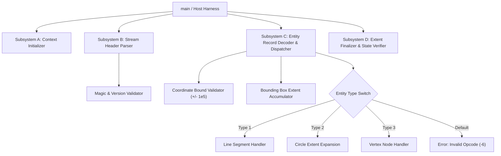

# BLIND_MODULE_MAP: Tier 2 Binary Architecture

## 1. Recovered Subsystems (Clean-Room Binary Analysis)

Based strictly on native structural analysis, exports, strings, and control-flow graphs recovered without consulting source code:

---

## 2. Subsystem Boundary Inventory

### Subsystem A: Context Lifecycle
- **Role:** Allocates and zeroes out the internal parser context.
- **Entry Function:** `FUN_INIT`
- **Observed State Variables:**
  - `state`: integer enum (initialized to 0)
  - `parsed_count`: 32-bit integer (initialized to 0)
  - `last_error`: 32-bit signed integer (initialized to 0)
  - `extent.is_valid`: boolean flag (initialized to 0)

### Subsystem B: Header & Protocol Validator
- **Role:** Ingests raw input buffer, checks byte length $\ge 16$, and verifies stream signature.
- **Observed Invariants:**
  - Invariant Constant 1: `0x43414453` (ASCII `'CADS'`) at offset 0.
  - Invariant Constant 2: Version unsigned short at offset 4 must be $> 0$ and $\le 2$.
  - Offset 8: 64-bit IEEE 754 floating point scale factor.
- **Terminal State:** Sets context state to `1` on success, or transitions to error state `4` returning error code `-2` (bad magic) or `-3` (version mismatch).

### Subsystem C: Entity Stream Dispatcher
- **Role:** Reads entity record chunks and mutates the global geometric extent.
- **Precondition:** Context state must be `1` (header parsed) or `2` (entities active).
- **Observed Dispatch Logic:**
  - Type 1 (Line): Reads 4 coordinate floats $(x_1, y_1, x_2, y_2)$, verifies $|coord| \le 100000.0$, expands extent.
  - Type 2 (Circle): Reads center $(x_1, y_1)$ and radius $r = x_2$. Rejects $r \le 0.0$ or $r > 100000.0$. Expands bounding box by $[x_1 - r, y_1 - r]$ and $[x_1 + r, y_1 + r]$.
  - Type 3 (Polyline Node): Single vertex $(x_1, y_1)$.
  - Any unknown type: Transitions to error state `4` returning `-6`.

### Subsystem D: Extent Finalizer
- **Role:** Confirms non-empty parsing and valid extents.
- **Validation:** If `parsed_count == 0` or extent is invalid, returns `-5`. Otherwise transitions to state `3` (Completed) and returns `0`.
